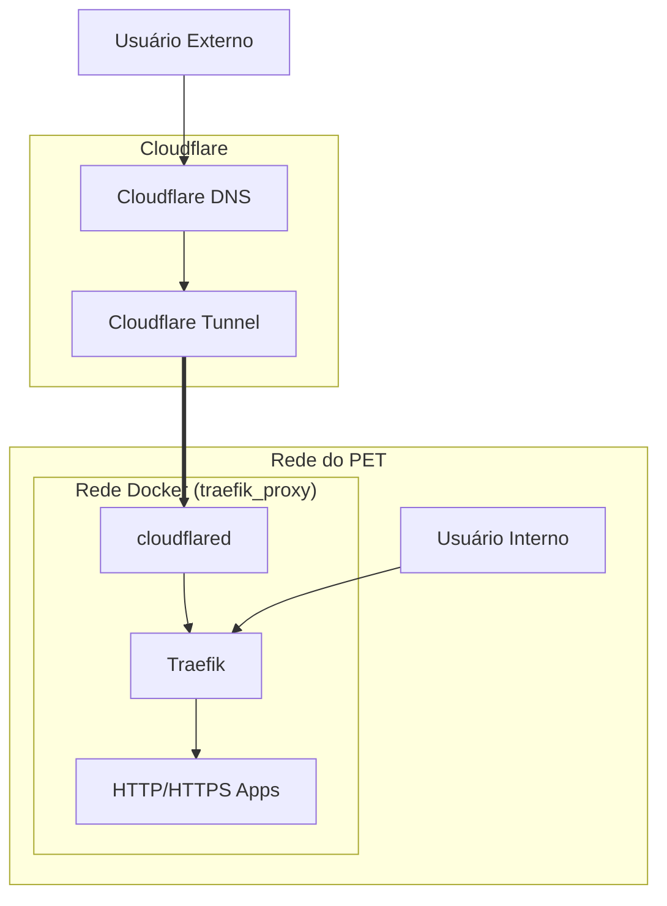

+++
title="PET-SI-Infraestrutura"
date="2026-08-10"
description="Descrição de como montar e operar o servidor do PET-SI"
[taxonomies]
tags=["university"]
+++

# PET-SI - Infraestrutura

Na EACH-USP, durante o ano de calouro, há uma competição denominada de BXComp, consiste em um campeonato separado em alguns dias em que consiste em resolver desafios feitos pelos veteranos em estilo maratona em equipes. Para essa competição acontecer é como utilizar uma plataforma de auto-correção de código e formação de equipes, porém desde a vez que eu participei, fiquei intrigado com o acesso somente em IPv4...

Nesse ano, conversando com o pessoal do PET, descobri que na sala reservada há uns computadores sem utilização que pelo que entendi já foram usados no passado para uso dos serviços do PET. Desde então propus e nesse artigo descrevo o servidor do PET!

## Hardware

Do que vi há uns 2-3 computadores com especificações parecidas, mas por enquanto foi somente usado um com o seguinte conjunto:

- **CPU**: Intel(R) Core(TM) i7-2600K (8) @ 3.80 GHz
- **GPU**: AMD Radeon HD 7450 - 1024M VRAM
- **Memory**: 8GB 1333 MT/s
- **Disk**: 1x 500GB HDD (ATA ST500DM002-1BD14)

## OS e ferramentas

Para o sistema operacional foi escolhido o Debian GNU/Linux pela sua alta estabilidade e familiaridade com o Universo mais próximo do Ubuntu GNU/Linux instalado pela universidade nos computadores dos laboratórios.

Como Stack principal de infraestrutura foi escolhido utilizar Containers em Docker. Fiz essa escolha porque containers permitem isolar os serviços evitando possíveis problemas e pelo aprendizado de quem quiser gerenciar, já que acho esse tipo de tecnologia fundamental de entender que existe, e o Docker por ser a ferramenta mais utilizada e documentada para essa tecnologia.

A internet fornecida para o computador chega direto da universidade cabeado, porém somente em IPv4 e com NAT, então foi necessário utilizar ferramentas e meios extras para o acesso. Dessa forma há o local pelo WI-FI da sala do PET, pelo Cloudflare Tunnels para os serviços públicos e formas de VPN que por enquanto a escolha foi o Tailscale.

## Software

### Pacotes instalador no Host (Debian)

Para conseguir todos os pacotes explicitamente instalados pelo usuário é possível filtar pelo historico de uso do APT:

```sh
zgrep -E "^Commandline:.*install" /var/log/apt/history.log* | grep -v '\-q' | cut -d':' -f3
```

Assim os pacotes e ferramentas CLI instalados incluem as seguintes:

```sh
sudo apt update
sudo apt upgrade -y
sudo apt --assume-no install -yq htop ncdu tar git unzip zip curl wget fastfetch nano vim lm-sensors gnupg figlet btop tmux bind9-dnsutils ca-certificates ethtool iperf3 rsync lsof bash-completion rsync sudo quota lshw fzf dos2unix avahi-daemon distrobox
```

Para instalar o Tailscale:

```sh
curl -fsSL https://tailscale.com/install.sh | sh
```

Para instalar o Docker:

```sh
# Add Docker's official GPG key:
sudo install -m 0755 -d /etc/apt/keyrings
sudo curl -fsSL https://download.docker.com/linux/debian/gpg -o /etc/apt/keyrings/docker.asc
sudo chmod a+r /etc/apt/keyrings/docker.asc

# Add the repository to Apt sources:
sudo tee /etc/apt/sources.list.d/docker.sources <<EOF
Types: deb
URIs: https://download.docker.com/linux/debian
Suites: $(. /etc/os-release && echo "$VERSION_CODENAME")
Components: stable
Architectures: $(dpkg --print-architecture)
Signed-By: /etc/apt/keyrings/docker.asc
EOF

sudo apt update
sudo apt install docker-ce docker-ce-cli containerd.io docker-buildx-plugin docker-compose-plugin
```

### Container

O principal container é o Portainer, um painel de controle em web para gerenciar o Docker, para instalar rode os seguintes comandos:

```sh
mkdir -p ~/compose/portainer
cat << 'EOF' > ~/compose/portainer/docker-compose.yml
services:
  portainer:
    container_name: portainer
    image: portainer/portainer-ce:lts
    ports:
      - 9443:9443
    volumes:
      - data:/data
      - /var/run/docker.sock:/var/run/docker.sock
    restart: unless-stopped
volumes:
  data:
EOF

sudo docker compose -f ~/compose/portainer/docker-compose.yml up -d
```

E para a configuração inicial acesse https://\<IP do servidor\>:9443/. Crie o usuário administrador e adicione o "environment" em "Socket".

#### Portainer

Após logar e acessar o environment nomeado por mim de local, há um menu na esquerda com as principais opções:

- **Stacks**: Aqui contém todos os docker-compose com status se é de controle total do Portainer ou criado externamente com o comando "docker compose" por exemplo. Pense que aqui será criado as "receitas de bolo" para subir serviços e containers.
- **Containers**: Os containers individuais propriamente ditos, será listado os nomes, status, imagens usadas, portas expostas e usadas no Host, etc
- **Images**: Lista todas as imagens baixadas e se estão sendo utilizadas ou não.
- **Networks**: Todas as subredes criadas pelo Docker, podendo ser gerenciadas por um compose ou não.
- **Volumes**: Todos os volumes criados pelos compose exceto os _bind mounts_. aqui irá conter quais diretórios do Host estão armazenados esses volumes que geralmente é onde é encontrado os dados permanentes e configurações dos serviços.

## Infraestrutura de serviços

Para expor múltiplos serviços utilizando as portas 80 (http) e 443 (https) é necessário o uso de um proxy reverso, há várias opções interessantes incluindo NGINX, NGINX proxy manager, Caddy, HAProxy, Envoy, Traefik. Esse último foi escolhido pela possibilidade de a configuração estar centralizada no próprio compose, com intrgração automática ao Docker e renovação automática dos certificador HTTPS em DNS na Cloudflare.

Como diagrama pode-se dizer que os acessos vão funcionar assim:



Para utilizar os serviços da Cloudflare é necessário ter um domínio registrado. Ter um SLD (second-level domain) tipo gabrielsouza.top é pago e para fins de infra foi utilizado alternativas Third-Level Domain que apesar de geralmente a Cloudflare não aceitar, vários listados na lista do [Public Suffix](https://publicsuffix.org/list/public_suffix_list.dat) são aceitos. Na data de hoje, foi registrado no provedor [DigitalPlat](https://domain.digitalplat.org/) um domínio .dpdns.org, lembrando de sempre preferir TLDs (top-level domain) de 3 letras ou mais, pois os de 2 letras são considerados ccTLDs (Country code TLD) o que significa que a existência do domínio fica sob jurisdição do país pertencente.

Após a criação do domínio, foi alterado o servidor NS (nameserver record) para os indicados durante a configuração inicial de adição do domínio na Cloudflare.
No painel da Cloudflare vá no menu esquerdo em "zero Trust"->"Networks"->"Tunnels & Mesh" e crie um Tunnel no tipo "Cloudflared", coloque um nome e copie o Token
Em outra aba, abra o [painel de "API Tokens"](https://dash.cloudflare.com/profile/api-tokens), crie com o template "Edit zone DNS" no domínio específico e copie o Token.

Agora abra o Portainer e em "Stacks" crie o "traefik" com o seguinte conteúdo base (leia e modifique conforme necessário) e variáveis de ambiente:

```yaml
services:
  traefik:
    image: traefik:v3.7
    container_name: traefik
    restart: unless-stopped
    security_opt:
      - no-new-privileges:true
    ports:
      - 80:80
      - 443:443
      - 8080:8080 # (optional) expose the dashboard !don't use in production!
    volumes:
      - config:/etc/traefik
      - /var/run/docker.sock:/var/run/docker.sock:ro
    networks:
      proxy:
    environment:
      CERTIFICATEMAIL:
      FQDNMAIN:
      FQDNSANS:
      CF_DNS_API_TOKEN:
    healthcheck: # enable healthchecks
      test: ["CMD", "traefik", "healthcheck", "--ping"]
      start_period: 5s
      interval: 5s
      timeout: 3s
      retries: 5
    labels:
      - "traefik.enable=true"
      - "traefik.http.routers.traefik.rule=Host(`traefik.petsi.dpdns.org`)"
      - "traefik.http.routers.traefik.entrypoints=websecure"
      - "traefik.http.services.traefik.loadbalancer.server.port=8080"
    command:
      # Global
      - "--global.sendanonymoususage=false"
      # EntryPoints
      - "--entrypoints.web.address=:80"
      - "--entrypoints.web.http.redirections.entrypoint.to=websecure"
      - "--entrypoints.web.http.redirections.entrypoint.scheme=https"
      - "--entrypoints.web.http.redirections.entrypoint.permanent=true"
      - "--entrypoints.websecure.address=:443"
      - "--entrypoints.websecure.http.tls=true"
      - "--entrypoints.websecure.http.tls.certresolver=letsencrypt"
      - "--entrypoints.websecure.http.tls.domains[0].main=$FQDNMAIN"
      - "--entrypoints.websecure.http.tls.domains[0].sans=$FQDNSANS"
      - "--entryPoints.websecure.forwardedHeaders.trustedIPs=127.0.0.1/32,172.16.0.0/12"

      # Certificate
      - "--certificatesresolvers.letsencrypt.acme.dnschallenge=true"
      - "--certificatesresolvers.letsencrypt.acme.dnschallenge.provider=cloudflare"
      - "--certificatesresolvers.letsencrypt.acme.dnschallenge.resolvers=1.1.1.1:53"
      - "--certificatesresolvers.letsencrypt.acme.email=$CERTIFICATEMAIL"
      - "--certificatesresolvers.letsencrypt.acme.storage=/etc/traefik/acme.json"

      # Providers
      - "--providers.docker=true"
      - "--providers.docker.exposedbydefault=false"
      - "--providers.docker.network=traefik_proxy"

      # API & Dashboard
      - "--api.dashboard=true"
      - "--api.insecure=true"

      # Observability
      - "--log=true"
      - "--log.level=DEBUG"
      - "--accesslog=true"
      - "--metrics.prometheus=true"
      - "--ping=true"

      # EITS
      - "--entrypoints.websecure.http.tls.domains[1].main=$FQDNMAINEITS"
      - "--entrypoints.websecure.http.tls.domains[1].sans=$FQDNSANSEITS"
  cloudflared:
    image: cloudflare/cloudflared
    container_name: cloudflared
    environment:
      - TZ=America/Sao_Paulo
      - TUNNEL_TOKEN=$CLOUDFLARE_TOKEN
      - TUNNEL_METRICS=127.0.0.1:20241
    restart: unless-stopped
    command: tunnel --no-autoupdate run
    healthcheck: # enable healthchecks
      test: ["CMD", "cloudflared", "tunnel", "ready"]
      start_period: 5s
      interval: 5s
      timeout: 3s
      retries: 5
    networks:
      proxy:
    depends_on:
      traefik:
        condition: service_healthy
  whoami:
    image: "traefik/whoami"
    container_name: "whoami"
    networks:
      proxy:
    labels:
      - "traefik.enable=true"
      - "traefik.http.routers.whoami.rule=Host(`petsi.dpdns.org`) || Host(`eits.dpdns.org`)"
      - "traefik.http.routers.whoami.entrypoints=websecure"
      - "traefik.http.services.whoami.loadbalancer.server.port=80"
    depends_on:
      - traefik
volumes:
  config:
  certs:
networks:
  proxy:
```

Em "Environment variables" adicione as seguintes variáveis:

```env
CLOUDFLARE_TOKEN=<token cloudflared>
CF_DNS_API_TOKEN=<token zona DNS>
CERTIFICATEMAIL=<email para solicitar certificados let's encrypt>
FQDNMAIN=<fqdn>
FQDNSANS=*.<fqdn>
FQDNMAINEITS=<fqdn secundário>
FQDNSANSEITS=*.<fqdn secundário>
```

Volte no painel de Tunnels, acesse o recém criado, vá na aba "Published application routes" e para cada entrada edite adicionando em "TLS"->"Origin Server Name" o hostname completo como descrito acima da página em "Hostname", ative também o "HTTP2 connection" e salve.

Se tudo está certo ao acessar a página do domínio, vai responder com o teste do serviço "whoami" já com HTTPS totalmente funcional.

### JudgeHost

Para hospedar o serviço JudgeHost para montar uma maratona de programação, é necessário rodar alguns comandos antes de criar a _stack_.

```sh
# 1. Back up your existing GRUB config
sudo cp /etc/default/grub /etc/default/grub.bak

# 2. Append missing flags to GRUB_CMDLINE_LINUX_DEFAULT
for flag in cgroup_enable=memory swapaccount=1 systemd.unified_cgroup_hierarchy=0; do
  sudo grep -q "^GRUB_CMDLINE_LINUX_DEFAULT=.*$flag" /etc/default/grub || \
  sudo sed -i -E "s/^(GRUB_CMDLINE_LINUX_DEFAULT=\"[^\"]*)/\1 $flag/" /etc/default/grub
done

sudo grub-mkconfig -o /boot/grub/grub.cfg
```

use o seguinte compose, criado a partir da documentação oficial e ajuda do tutorial de como rodar na AWS feito pela [Giane Mayumi](https://github.com/Anemaygi/domjudge) com as variáveis:

```yaml
x-common-configuration: &common-configuration
  image: domjudge/judgehost:latest
  privileged: true
  restart: unless-stopped
  volumes:
    - /sys/fs/cgroup:/sys/fs/cgroup
  depends_on:
    domserver:
      condition: service_healthy

services:
  mariadb:
    container_name: mariadb
    image: mariadb:latest
    env_file:
      - stack.env
    volumes:
      - mysql:/var/lib/mysql
    command: --max-connections=1000 --innodb-log-file-size=2G --max-allowed-packet=512M
    restart: unless-stopped
    healthcheck:
      test: ["CMD", "healthcheck.sh", "--connect", "--innodb_initialized"]
      start_period: 15s
      interval: 10s
      timeout: 5s
      retries: 3

  domserver:
    container_name: domserver
    image: domjudge/domserver:latest
    restart: unless-stopped
    volumes:
      - /sys/fs/cgroup:/sys/fs/cgroup:ro
      - public_images:/opt/domjudge/domserver/webapp/public/images
      - public_css:/opt/domjudge/domserver/webapp/public/css/custom
      - public_js:/opt/domjudge/domserver/webapp/public/js/custom
      - public_docs:/opt/domjudge/domserver/webapp/public/docs
    ports:
      - 12345:80
    networks:
      - default
      - traefik_proxy
    depends_on:
      mariadb:
        condition: service_healthy
    environment:
      - CONTAINER_TIMEZONE=America/Sao_Paulo
      - MYSQL_HOST=mariadb
      - MYSQL_DATABASE=$MYSQL_DATABASE
      - MYSQL_USER=$MYSQL_USER
      - MYSQL_PASSWORD=$MYSQL_PASSWORD
    healthcheck:
      test: ["CMD", "curl", "-f", "http://localhost/api/v4/"]
      interval: 10s
      timeout: 5s
      retries: 5
      start_period: 15s
    labels:
      - "traefik.enable=true"
      - "traefik.http.routers.domjudge.rule=Host(`bxcomp.petsi.dpdns.org`)"
      - "traefik.http.routers.domjudge.entrypoints=websecure"
      - "traefik.http.services.domjudge.loadbalancer.server.port=80"

  judgehost-0:
    <<: *common-configuration
    container_name: judgehost-0
    hostname: judgedaemon-0
    environment:
      - DAEMON_ID=0
      - CONTAINER_TIMEZONE=America/Sao_Paulo
      - JUDGEDAEMON_PASSWORD=$JUDGEDAEMON_PASSWORD

  judgehost-1:
    <<: *common-configuration
    container_name: judgehost-1
    hostname: judgedaemon-1
    environment:
      - DAEMON_ID=1
      - CONTAINER_TIMEZONE=America/Sao_Paulo
      - JUDGEDAEMON_PASSWORD=$JUDGEDAEMON_PASSWORD

  judgehost-2:
    <<: *common-configuration
    container_name: judgehost-2
    hostname: judgedaemon-2
    environment:
      - DAEMON_ID=2
      - CONTAINER_TIMEZONE=America/Sao_Paulo
      - JUDGEDAEMON_PASSWORD=$JUDGEDAEMON_PASSWORD

  judgehost-3:
    <<: *common-configuration
    container_name: judgehost-3
    hostname: judgedaemon-3
    environment:
      - DAEMON_ID=3
      - CONTAINER_TIMEZONE=America/Sao_Paulo
      - JUDGEDAEMON_PASSWORD=$JUDGEDAEMON_PASSWORD
volumes:
  mysql:
  public_images:
  public_css:
  public_js:
  public_docs:
networks:
  traefik_proxy:
    external: true
```

Adicione as seguintes ENVs, trocando as senhas por saídas aleatórias geradas por esse comando:

```sh
tr -dc 'A-Za-z0-9_!@#$%&*' < /dev/random | head -c 64;echo
```

```env
MYSQL_DATABASE=bxcomp
MYSQL_USER=bxcomp
MYSQL_PASSWORD=<generated pwd>
MYSQL_ROOT_PASSWORD=<generated pwd>
JUDGEDAEMON_PASSWORD=
```

Na primeira vez que os containers rodarem, os judgehost-* irão morrer, pois deixamos a senha "JUDGEDAEMON_PASSWORD" vazia. Para conseguir a senha certa copie do comando `docker logs domserver` e adicione editando a *stack\* e então execute o "Update the stack".
Pronto! Se tudo estiver certo é para ter um servidor JudgeHost rodando. Acredite essa é a forma mais fácil de obter tudo rodando.

## Manutenção

Para os navegantes que apesar de achar legal ver funcionando ainda não conhece todos os mecanismos descritos está alguns comandos importantes para diagnosticar alguns problemas que podem acontecer nesse sistema:

### Linux

Ver todas as portas expostas ouvindo no sistema:

```sh
ss -tulpn | grep LISTEN
```

Ver uso total dos discos:

```sh
df -h
```

Ver resumo do sistema (gerenciador de tarefas):

```sh
btop
htop
```

Ver temperaturas atuais do sistema:

```sh
sensors
```

Busca por arquivo, pasta, ou interativo (TUI) dentro da pasta atual:

```sh
find . -type f -name "*<substring no nome>*"
find . -type d -name "*<substring no nome>*"
fzf
```

Manual, _tldr_ (too long don't read) para cada comando:

```
man <comando>
curl cheat.sh/<comando>
```

#### **Importante**: Ver se o sistema está gargalando ou está aguentando a carga:

```sh
uptime
```

Exemplo de saída:

```
14:39:04 up 6 days, 1:38, 4 users, load average: 0.14, 0.18, 0.17
```

Esse comando mostra a quanto tempo o sistema está ligado, quantas sessões de usuários logados e o mais importante a média de load dos últimos 1 min, 5 min, 15 min. Para interpretar é necessário saber a quantidade de _threads_ do processador, nesse caso há 8 threads, assim valores abaixo de 8 significam que o sistema está conseguindo escalonar todos os processos normalmente, caso estiver acima, analisar o que está acontecendo, pois o sistema não está conseguindo processar tudo.

### Docker

Ver todos os containers rodando:

```sh
docker ps
```

Ver todos os containers criados, rodando ou não:

```sh
docker ps -a
```

Ver logs de determinado container:

```sh
docker logs <nome ou ID container>
```

Ver uso de recursos do sistema para cada container

```sh
docker stats
```

Entrar no shell/executar comando de um determinado container:

```sh
docker exec -it <nome ou ID container> sh
docker exec -it <nome ou ID container> bash

docker exec -it <nome ou ID container> ls /
```

Iniciar, parar, reiniciar container específico:

```sh
docker start/stop/restart <nome ou ID container>
```

Ver todos os detalhes de um container específico:

```sh
docker inspect <nome ou ID container>
```

Limpar containers parados, redes não usadas e imagens sem tag (dangling):

```
docker system prune
```
